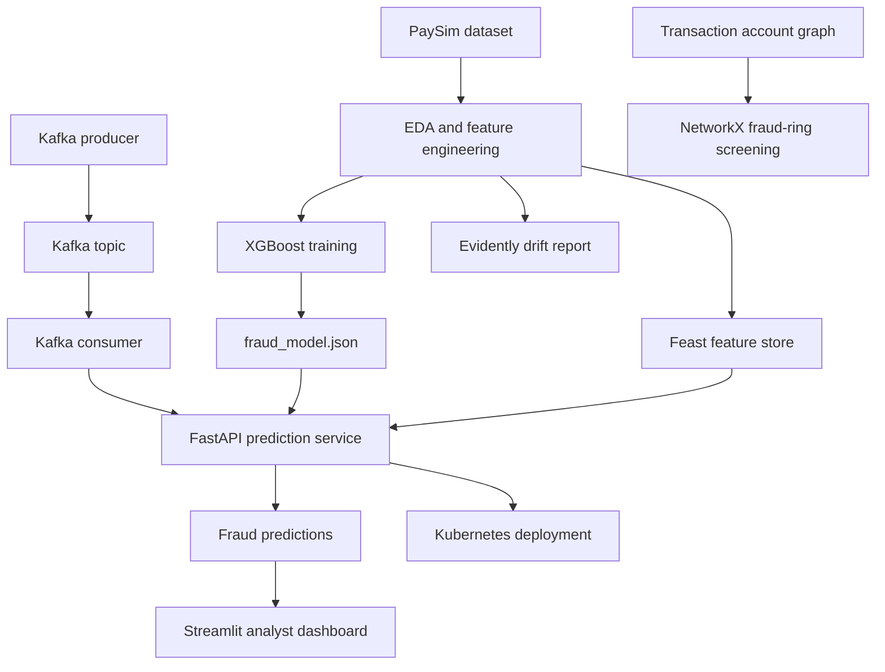

# Real-Time Financial Fraud Detection Platform

An end-to-end prototype that scores financial transactions for fraud risk, streams transactions through Kafka, serves predictions through FastAPI, stores serving features in Feast, and provides an analyst dashboard.

## Problem

Financial fraud detection is challenging because fraudulent transactions are rare and must be identified quickly. This project uses the PaySim synthetic mobile-money dataset to explore imbalanced classification, streaming inference, feature serving, monitoring, and graph-based screening.

## Architecture



## Technology

- Python, pandas and scikit-learn
- XGBoost for transaction classification
- Kafka for transaction streaming
- FastAPI for prediction endpoints
- Feast for feature retrieval
- MLflow for experiment tracking
- Streamlit for analyst review
- Evidently AI for drift reporting
- NetworkX for graph-based screening
- Docker and Kubernetes for deployment

## Project components

| File | Purpose |
|---|---|
| `train_model.ipynb` | Model training workflow |
| `data_analysis.ipynb` | Exploratory data analysis |
| `feature_engineering.ipynb` | Feature preparation |
| `fraud_model.json` | Saved XGBoost model |
| `app.py` | FastAPI service |
| `kafka_producer.py` | Sends sample transactions |
| `kafka_consumer.py` | Consumes transactions and requests predictions |
| `dashboard.py` | Analyst dashboard |
| `prepare_features.py` | Prepares Feast feature data |
| `create_feast_sample.py` | Creates sample feature records |
| `monitor_drift.py` | Generates drift report |
| `graph_fraud_rings.py` | NetworkX graph screening |
| `dockerfile` | API container image |
| `docker-compose.yml` | Local container configuration |
| `k8s-deployment.yaml` | Kubernetes deployment and service |
| `predict.py` | Prediction utility |

## Setup

Use Python 3.11 and run commands from the project directory.

Create and activate a virtual environment:

```powershell
python -m venv .venv
.\.venv\Scripts\Activate.ps1
python -m pip install --upgrade pip
pip install -r requirements.txt
```

The base `requirements.txt` currently contains the API dependencies. Other workflows may require additional packages for Feast, Streamlit, MLflow, Evidently, Kafka clients and their supporting services.

Place the PaySim dataset in the expected location before running the notebooks or feature preparation scripts. Do not commit large datasets or generated output files.

## Run the API

```powershell
uvicorn app:app --reload
```

Open `http://127.0.0.1:8000/docs` to inspect the API interactively.

## API endpoints

| Method | Endpoint | Purpose |
|---|---|---|
| GET | `/` | API root |
| POST | `/predict` | Score a transaction |
| GET | `/features/{transaction_id}` | Retrieve Feast features |
| GET | `/predict-from-feast/{transaction_id}` | Retrieve features and score a transaction |

Use the interactive API documentation to inspect request schemas and responses.

## Dashboard

```powershell
python -m streamlit run dashboard.py
```

## Monitoring and graph screening

Run `monitor_drift.py` to generate a drift report and open `drift_report.html`. The current workflow produces a report; an automated retraining trigger is not yet implemented.

Run `graph_fraud_rings.py` for NetworkX-based graph screening. This is a heuristic, not a trained PyTorch Geometric graph neural network, and its output should not be treated as confirmed fraud.

## Evaluation

The model training workflow reported a PR-AUC of approximately `0.9954`. Reproduce the evaluation and verify that preprocessing and train/test splitting prevent data leakage before treating this as a final performance result. PaySim is synthetic data, so results do not establish real-world banking performance.

## Deployment

The API has been tested with Docker and a local Docker Desktop Kubernetes cluster. Kafka, Feast and the dashboard may need their own configuration and services when reproducing the full workflow.

## Limitations and next steps

- Implement and validate a PyTorch Geometric graph neural network.
- Blend graph risk with the XGBoost score and evaluate the combined model.
- Add a monitored, tested automatic retraining trigger.
- Expand automated tests and document reproducible performance measurements.
- Configure all service dependencies for a clean deployment.

## Responsible use

This is an educational prototype, not a production banking system. Predictions are risk estimates and should be reviewed alongside other evidence. Do not use the model as the sole basis for adverse decisions about customers.
